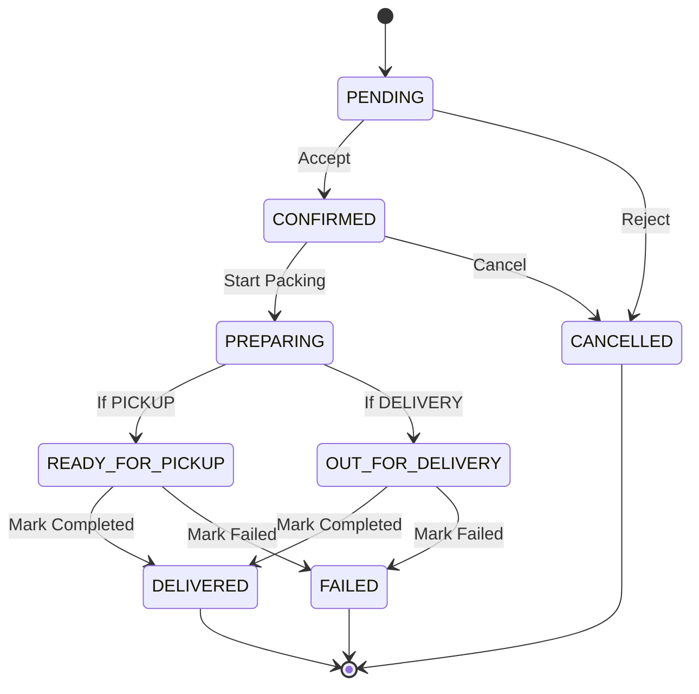

# Vendor — Domain Models & Business Rules

> [← Back to Vendor Index](./README.md)

---

## Purpose

This document outlines the core TypeScript domain models and pure business validation rules in `vendor/src/features/vendor/model.ts` and `vendor/src/features/vendor/rules.ts`.

These models strictly mirror the NestJS backend DTOs (`server/src/modules/**/dto`) ensuring wire-level compatibility between client and server.

---

## 1. Domain Models (`model.ts`)

### Store & Operations

```typescript
export type WeekDay = "MONDAY" | "TUESDAY" | "WEDNESDAY" | "THURSDAY" | "FRIDAY" | "SATURDAY" | "SUNDAY";
export type StoreStatus = "PENDING" | "ACTIVE" | "TEMPORARILY_CLOSED" | "SUSPENDED" | "CLOSED";
export type VerificationStatus = "PENDING" | "VERIFIED" | "REJECTED";

export type Store = {
  id: string;
  name: string;
  slug: string;
  description: string | null;
  phone: string;
  email: string | null;
  gstNumber: string | null;
  businessRegistrationNumber: string | null;
  addressLine1: string;
  addressLine2: string | null;
  city: string;
  state: string;
  country: string;
  pincode: string;
  latitude: number;
  longitude: number;
  timezone: string;
  status: StoreStatus;
  verificationStatus: VerificationStatus;
  verifiedAt: string | null;
  isOpen: boolean;
  logoKey: string | null;
  bannerKey: string | null;
  createdAt: string;
  updatedAt: string;
};

export type StoreHour = {
  id: string;
  weekDay: WeekDay;
  openingTime: string | null; // "HH:MM"
  closingTime: string | null; // "HH:MM"
  isClosed: boolean;
};

export type DeliverySettings = {
  id: string;
  isDeliveryAvailable: boolean;
  isPickupAvailable: boolean;
  minimumOrderAmount: number;
  deliveryRadiusKm: number;
  deliveryCharge: number;
  freeDeliveryAbove: number | null;
  estimatedDeliveryTime: number; // minutes
};
```

---

### Catalog & Products

```typescript
export type AvailabilityStatus = "AVAILABLE" | "OUT_OF_STOCK" | "HIDDEN" | "DISCONTINUED";

export type MasterProduct = {
  id: string;
  categoryId: string;
  brandId: string | null;
  unitId: string;
  name: string;
  slug: string;
  description: string | null;
  sku: string;
  barcode: string | null;
  hsnCode: string | null;
  gstRate: string;
  unitValue: string;
  isVeg: boolean | null;
  isFeatured: boolean;
  status: "ACTIVE" | "INACTIVE" | "DISCONTINUED";
};

export type StoreProduct = {
  id: string;
  storeId: string;
  masterProductId: string;
  mrp: string;
  sellingPrice: string;
  availabilityStatus: AvailabilityStatus;
  trackInventory: boolean;
  isFeatured: boolean;
  displayOrder: number;
  createdAt: string;
  updatedAt: string;
};
```

---

### Inventory & Stock Transactions

```typescript
export type InventoryTransactionType =
  | "PURCHASE"   // Stock In
  | "RESTOCK"    // Stock In
  | "RETURN"     // Stock In
  | "SALE"       // Stock Out
  | "DAMAGE"     // Stock Out
  | "EXPIRED"    // Stock Out
  | "ADJUSTMENT"; // Generic (rejected by backend in favor of specific types)

export type InventoryReferenceType = "ORDER" | "PURCHASE" | "RETURN" | "MANUAL";

export type Inventory = {
  id: string;
  storeProductId: string;
  stockQuantity: number;
  reservedQuantity: number;
  lowStockThreshold: number;
  reorderLevel: number;
  version: number; // Optimistic Concurrency Control
  lastStockUpdate: string | null;
};

export type AdjustInventoryInput = {
  transactionType: InventoryTransactionType;
  quantity: number;
  referenceType?: InventoryReferenceType;
  notes?: string;
  expectedVersion: number;
};
```

---

### Orders & Line Items

```typescript
export type OrderStatus =
  | "PENDING"
  | "CONFIRMED"
  | "PREPARING"
  | "READY_FOR_PICKUP"
  | "OUT_FOR_DELIVERY"
  | "DELIVERED"
  | "CANCELLED"
  | "FAILED";

export type FulfillmentType = "DELIVERY" | "PICKUP";
export type PaymentStatus = "PENDING" | "AUTHORIZED" | "PAID" | "FAILED" | "CANCELLED" | "PARTIALLY_REFUNDED" | "REFUNDED";
export type PaymentMethod = "COD" | "UPI" | "CARD" | "NET_BANKING" | "WALLET";

export type Order = {
  id: string;
  orderNumber: string;
  status: OrderStatus;
  paymentStatus: PaymentStatus;
  paymentMethod: PaymentMethod;
  fulfillmentType: FulfillmentType;
  subtotal: number;
  discountAmount: number;
  taxAmount: number;
  deliveryFee: number;
  totalAmount: number;
  deliveryReceiverName: string;
  deliveryPhone: string;
  deliveryHouseNo: string;
  deliveryStreet: string;
  deliveryArea: string;
  deliveryLandmark: string | null;
  deliveryCity: string;
  deliveryPincode: string;
  deliveryInstructions: string | null;
  placedAt: string;
  items: OrderItem[];
};
```

---

## 2. Pure Business Rules (`rules.ts`)

### Pricing Validation (`validatePrice`)

Vendors can never set an invalid selling price:
- `mrp` must be strictly greater than `0`.
- `sellingPrice` must be strictly greater than `0`.
- `sellingPrice` cannot exceed `mrp`.

```typescript
export const validatePrice = (mrp: number, selling: number): string | null => {
  if (!(mrp > 0)) return "MRP must be more than ₹0";
  if (!(selling > 0)) return "Selling price must be more than ₹0";
  if (selling > mrp) return "Selling price can't be higher than MRP";
  return null;
};
```

---

### Optimistic Concurrency & Stock Delta (`applyStockChange`)

The client models the backend `InventoryService.getQuantityDelta` logic:
- Inflow transactions (`PURCHASE`, `RESTOCK`, `RETURN`) add positive delta.
- Outflow transactions (`SALE`, `DAMAGE`, `EXPIRED`) subtract delta.
- Checks:
  - Quantity must be an integer $\ge 1$.
  - Resulting stock cannot fall below 0.
  - Resulting stock cannot fall below `reservedQuantity` (units reserved for pending orders).

```typescript
export const applyStockChange = (
  stock: number,
  reserved: number,
  type: InventoryTransactionType,
  quantity: number,
): { stock: number } | { error: string } => {
  if (!Number.isInteger(quantity) || quantity < 1) return { error: "Quantity must be at least 1" };
  const next = stock + stockDelta(type, quantity);
  if (next < 0) return { error: "Stock can't go below zero" };
  if (next < reserved) return { error: "Stock can't be lower than units reserved for orders" };
  return { stock: next };
};
```

---

### Order State Transition Rules (`nextOrderStatuses`)

A vendor can only transition orders along permitted paths based on `fulfillmentType`:


